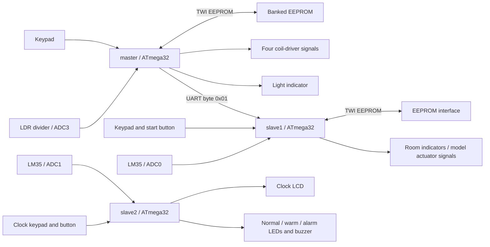

# ATmega32 Smart-Home Demonstrator

An **Embedded C** teaching project with three ATmega32 firmware images: keypad
access/door sequencing, an LCD-based device/temperature interface, and a clock
with temperature-warning indicators. Project period: **August–September 2023**
(owner-provided). A Proteus project and historical ELF files are included.

This is a low-voltage educational demonstrator. It is not a deployed home
security, fire-alarm or HVAC product. **MQTT, HTTP/REST, Docker, Python services,
machine learning, cloud integration, humidity/PIR sensing and role-based accounts
are not implemented.** The previous README/badges overstated the source.

## Problem and architecture

The project explores MCU peripherals and integration: digit input, LCD output,
EEPROM transactions, a UART activation byte, analog sensing and cooperative timed
tasks. Application and driver layers are separated into APP, SERVICE, HAL, MCAL,
LIB and TMU folders in the original three Eclipse projects.



EEPROM blocks describe interfaces, not verified physical bus topology. The
third controller runs independently; there is no implemented three-node network
protocol. Names `master`, `slave1`, `slave2` are retained for project compatibility.

## What the applications actually do

| Image | Implemented application path |
|---|---|
| `master` | Set a four-digit demo PIN at boot, store/read it through external EEPROM, allow three comparisons, sequence a stepper door on success, send activation byte, then poll LDR/light output |
| `slave1` | Wait for UART `0x01`, accept start/menu input, expose device controls and temperature setpoint; password-change readback and display-only phone/emergency digit entry |
| `slave2` | Timer tick marks foreground tasks for temperature warning, nonblocking clock input and 24-hour clock display |

`common/HomeLogic.c` holds tested decimal validation, LM35 conversion,
temperature-zone classification and bounded integer formatting. Duplicate
historical driver folders remain aligned where fixes apply; a whole driver-tree
migration was avoided to preserve Eclipse/Proteus project layout.

The revised default thermostat keeps outputs off until a numeric setpoint is
entered. Automatic and manual heat/cool requests exclude the opposing output.
This is software logic only; no physical relay polarity or heating equipment
has been validated.

## Hardware and connections

Source and Eclipse settings target **ATmega32 at 8 MHz**, GNU AVR C99. Source
interfaces include a 3-column/4-row keypad, four-bit LCD, LM35, LDR divider,
banked TWI EEPROM, UART, indicator/buzzer outputs and a four-coil stepper driver.
The Proteus archive contains ATMEGA32, LM35, 24C04F/24C08 and LCD model references;
that does not establish the exact as-built physical parts or wiring.

Read [the source-derived wiring guide](docs/wiring.md). Important connections:

| Controller | Function | Source pins |
|---|---|---|
| master | Keypad columns / rows | PA0–PA2 / PA4–PA7 |
| master | Stepper coil-driver signals | PD4–PD7 |
| master | LDR / light output | PA3 / PB3 |
| master | Access success / failure / buzzer | PC2 / PC3 / PC4 |
| master → slave1 | UART TX → RX, common ground | PD1 → PD0, nominal 9600 8N1 |
| slave1 | LM35 / start button | PA0 / PD6 (active low) |
| slave1 | Keypad columns / rows | PD2,PD4,PD5 / PD7,PA5,PA6,PA7 |
| slave1 | Room light / AC / heater signals | PC2/PC3/PC4; PC5/PC6/PC7; PA2/PA3/PA4 |
| slave1 | Garden gate / light | PD3 / PB3 |
| slave2 | LM35 / clock-entry button | PA1 / PC0 (active low) |
| slave2 | Keypad columns / rows | PD0–PD2 / PD4–PD7 |
| slave2 | Normal / warm / alarm / buzzer | PC1 / PC2 / PC3 / PC4 |
| All | LCD RS/RW/E; D4–D7 | PB0/PB1/PB2; PB4–PB7 |
| master, slave1 | Hardware TWI | PC0 SCL / PC1 SDA |

Use suitable drivers, low-voltage loads, current limiting, decoupling and common
logic references. Do not drive motors, relay coils or mains appliances directly
from MCU pins. Check ATmega32 JTAG use on PC2–PC5 and the actual fuse/clock settings;
this repository does not program fuses automatically.

## Build and setup

Install GNU AVR GCC, avr-libc, binutils-avr, Make and a host GCC. Tested AVR
compiler: **7.3.0-atmel3.6.1-arduino7**, atmega32/8 MHz, `-Os`. The code uses no
Arduino runtime; the pinned CI uses Arduino's packaged AVR compiler as a toolchain.

```bash
git clone https://github.com/fady-salib/smart-home-project.git
cd smart-home-project
make
make test
```

`make` produces `build/master.hex`, `build/slave1.hex` and `build/slave2.hex`,
plus ELF/map files. Both firmware and host checks treat warnings as errors;
firmware disables common-symbol merging. If tools are not on PATH:

```bash
make CC=/path/to/avr-gcc OBJCOPY=/path/to/avr-objcopy SIZE=/path/to/avr-size
```

Do not override MCU/clock without reviewing the direct register map, UART baud,
TWI constants, delay calibration and 1 kHz tick setup. No upload/programmer target
is provided; choose an appropriate programmer only after verifying actual wiring.
Root `ITI_*.elf` files are historical artifacts, **not rebuilt review outputs**.

For a Proteus check, open `ITI_SmartHome_Simulation.pdsprj`, inspect its component
identities and nets, and manually select the three newly built images for the
corresponding controllers. Set the simulated clocks to 8 MHz and verify each
controller mapping. Proteus was not available/executed in this review; component
references and project files alone are not proof of a passing simulation.

## Demonstration workflow

1. Begin with logic indicators/unloaded model outputs. Verify supplies, JTAG,
   LCD, pull-ups, EEPROM addressing and UART crossing.
2. Boot the master; enter four decimal digits to provision the **demo** PIN.
   Failed storage readback returns without door motion or UART activation.
3. Enter the same four digits to exercise the source door sequence and activation
   byte. Test three incorrect attempts separately; confirm no unlock request.
4. On slave1, press the active-low start button, enter `#` and select a menu.
   Temperature outputs stay off until a two-digit setpoint is entered. Phone
   menus display digits only; they do not save numbers or send calls/messages.
5. On slave2, use the clock-entry button and six HHMMSS digits. Invalid times are
   rejected without a keypad wait inside the timer ISR. Temperature thresholds
   are <45°C normal, 45–69°C warm, ≥70°C alarm indication.
6. Vary the simulated LM35/LDR inputs and capture indicators. Label video as
   simulation or physical bench evidence; do not call it a certified alarm test.

The original stepper's 60 forward / 73 reverse sequence counts are retained;
they are not measured angles and can cause drift. Verify mounting/travel with
loads removed before any powered mechanism demo.

## Testing and measured results

Before edits, all three images compiled but emitted **132 warnings**. On
2026-10-29 the reviewed firmware compiled with `-Wall -Wextra -Werror -fno-common`
and no warnings. Eight host executables passed with AddressSanitizer and UBSan:
real-source access/password/phone flows, LM35 guard bytes, register models,
keypad, scheduler, clock/temperature and thermostat behavior.

| Reviewed image | Program bytes | Static SRAM bytes |
|---|---:|---:|
| master | 4,976 | 193 |
| slave1 | 6,856 | 720 |
| slave2 | 3,818 | 131 |

ATmega32 has 32 KiB flash / 2 KiB SRAM. Static figures do not measure peak stack
or electrical performance. See [verification](docs/verification.md) for exact
commands, warning history and mock limitations. In a ptrace-restricted runner,
use `ASAN_OPTIONS=detect_leaks=0 make test`; leak detection is then disabled.
The added CI definition is separate from any verified remote run.

## Security and other limitations

- PIN provisioning still occurs at every master boot. Anyone with reset/keypad
  access can replace it; the PIN is stored in plaintext. This is an input/EEPROM
  demonstration, **not tamper-resistant access control**. Password-change writes
  are read back but not transactional across power loss.
- EEPROM PIN slots now use first-bank `0x0034` / `0x0045` instead of invalid
  high addresses. Existing EEPROM data needs re-provisioning. Confirm EEPROM
  capacity/address straps and whether the two controllers share a physical bus;
  multi-master arbitration has not been validated.
- UART `0x01` is unframed and unauthenticated, without checksum, acknowledgment
  or reconnection policy. Slave1 may wait indefinitely at startup. UART/ADC
  hardware waits remain blocking; TWI polling is bounded and checks statuses.
- Cooperative tasks can run late; missed periods coalesce. Clock time is not a
  battery-backed RTC. Keypad scanning reports one event per press but still needs
  measured debounce/signal-integrity work. LCD and sensor work take finite time.
- LM35 conversion assumes 5 V ADC reference and 10 mV/°C, saturates to an 8-bit
  value and is uncalibrated. Sensor disconnection, hysteresis, actuator failure
  and electrical polarity are not comprehensively detected. No actual smoke
  sensing exists despite legacy variable/comments.
- The unused stepper half-step sequence and unused SPI/external-interrupt paths
  need separate review. An LCD custom-character stub now honestly returns failure.
  Blocking menus can defer automatic temperature updates on slave1.

## Future work, media, ownership and license

Priorities: verify the as-built schematic/components and individual contributions;
measure ADC scaling, debounce and task timing; test TWI bus failures; replace
boot-time PIN replacement with a reviewed provisioning policy; add explicit UART
framing/timeouts and actuator interlocks. MQTT/REST/cloud interfaces would be
**future features**, not implemented capabilities.

No new media was supplied. Add original photographs and a stable demo video link
with dates, firmware revision and simulation/physical labels under `docs/media/`.
Capture board labels, keypad/LCD interaction, threshold boundary behavior and
failure cases using non-sensitive test PINs. Avoid faces/private phone numbers.

Fady Salib is the repository owner. Existing source headers credit `M.H` and
`Hanos_000`; these are preserved and do not prove Fady's individual scope. Confirm
team/ITI teaching-source attribution before claiming sole driver authorship.
This review used AI-assisted code audit, fixes, tests and documentation. There
is **no project LICENSE file**; the former MIT badge was unsupported. Clarify
source ownership and licensing before adding a license grant.

[Detailed audit and inventory](docs/audit.md) · [Wiring](docs/wiring.md) ·
[CV and LinkedIn drafts](docs/portfolio.md)
