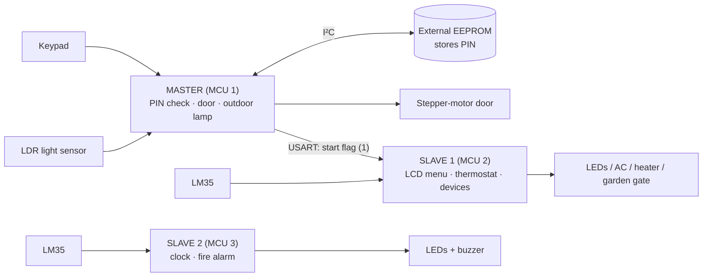

# Smart Home — three-ATmega32 home automation system

ITI final project: a password-protected smart home built from **three ATmega32 microcontrollers** running
bare-metal C on a hand-written, layered driver stack (no Arduino, no vendor HAL).

| MCU | Folder | Role |
|-----|--------|------|
| 1 — **Master** | [`master/`](master) | Entrance security: keypad PIN → stepper-motor door. Light-sensing outdoor lamp. Wakes Slave 1 once the PIN is accepted. |
| 2 — **Slave 1** | [`slave1/`](slave1) | Control panel: LCD menu, thermostat (AC / heater), per-room device switching, garden gate. |
| 3 — **Slave 2** | [`slave2/`](slave2) | Standalone safety/clock node: real-time clock display and three-level fire alarm. Uses the TMU task scheduler. |



## How it works

**Master**
1. On boot the user sets a 4-digit PIN on the keypad; it is split into two bytes and written to the external EEPROM over I²C (TWI).
2. The user re-enters the PIN — three attempts. A wrong try flashes the red LED; three failures show `ACCESS DENIED`, light the red LED and sound the buzzer.
3. A correct PIN lights the green LED, opens the door (stepper motor), closes it again after 3 s, and sends a start flag (`1`) to Slave 1 over USART.
4. Afterwards it runs the LDR loop: ADC channel 3 switches the outdoor lamp on when it gets dark.

**Slave 1** — idles until it receives the start flag, then shows a welcome screen with the live temperature.
`#` opens the settings menu: *Security* (change password, emergency number, phone number) and *Services*
(set temperature, switch devices per room, garden gate, electricity management, set time, rating).
The thermostat compares the LM35 reading to the set point and drives the AC or heater output.

**Slave 2** — two periodic tasks on the [TMU](slave2/TMU) scheduler: a 1 s clock (1 ms scheduler tick; press the button on PC0 to set `HH:MM:SS` on the keypad) and a 50 ms fire-alarm check on an LM35:

| Temperature | State | Output |
|-------------|-------|--------|
| < 45 °C | Normal | white LED |
| 45 – 70 °C | Heat zone | yellow LED |
| ≥ 70 °C | Danger | red LED + buzzer |

## Software architecture

Each firmware image uses the same layered, register-level stack:

```
APP.c            application entry point (main)
SERVICE/         security, interactive LCD menu, device/thermostat logic
HAL/             LCD, keypad, LM35, stepper motor, external EEPROM
TMU/             time-management unit (cooperative task scheduler on a hardware timer)
MCAL/            DIO, ADC, USART, TWI (I²C), SPI*, external & global interrupts, timer (GPT)
LIB/             STD_TYPES.h, BIT_MATH.h
```
<sub>\* SPI driver is present in the master only.</sub>

Naming follows the usual ITI convention: `<Module>_Interface.h` (public API), `<Module>_Private.h`
(registers), `<Module>_Config.h` (compile-time options), `<Module>_Prog.c` (implementation).

## Hardware

- 3 × ATmega32, clock set to 8 MHz in the project settings (`.settings/*.prefs`, `-DF_CPU=8000000UL`)
- Character LCD (LCD data on PORTB), 3×4 keypads, LM35 temperature sensors, LDR, stepper motor, LEDs, buzzer
- External I²C EEPROM, 24Cxx-style (master); USART link master → slave 1 (master TX on PD1 → slave 1 RX on PD0, common ground)

Key pins (verified from the source; other pins are in the `SERVICE/` files):

| | Master | Slave 2 |
|---|---|---|
| Keypad | PA0–PA2 (columns), PA4–PA7 (rows) | PD0–PD2 (columns), PD4–PD7 (rows) |
| Sensors | LDR on ADC3 (PA3) | LM35 on ADC1 (PA1) |
| Outputs | Stepper PD4–PD7 · green LED PC2 · red LED PC3 · buzzer PC4 · outdoor lamp PB3 | White/yellow/red LED PC1/PC2/PC3 · buzzer PC4 |
| Other | USART PD0/PD1 · I²C PC0/PC1 | Set-clock button PC0 (active low, pull-up) |

## Building

**Eclipse (original workflow)** — install the [AVR Eclipse plugin](https://avr-eclipse.sourceforge.net/), then
*File → Import → Existing Projects into Workspace* and select the repo root. The three projects import side by side
(`ITI_MASTER_1`, `ITI_SLAVE_1`, `ITI_SLAVE_2`). Build the *Debug* or *Release* configuration.

**Command line** — requires `avr-gcc`, `avr-libc` and `make`:

```bash
make               # builds build/master.hex, build/slave1.hex, build/slave2.hex
make master        # or just one image
```

Flash with your programmer, e.g. USBasp:

```bash
avrdude -p m32 -c usbasp -U flash:w:build/master.hex
```

> The Makefile defaults to `-Os`. avr-libc's `_delay_ms()` is only accurate with optimisation on; the Eclipse *Debug*
> configuration uses `-O0`, so delays (door timing, etc.) will differ if you build that way.

## Repository notes

This repo was cleaned up from the original course-project archive:

- Removed generated build output (`Debug/`, `.o`, `.elf`, `.lss`, `.map`), nested `.git` folders, a duplicate nested `ITI_SLAVE_1/ITI_SLAVE_1`, empty folders, and prebuilt `.elf` files (attach firmware to a GitHub Release instead of committing it).
- Converted CRLF → LF; added `.gitignore`, `.gitattributes` and a Makefile.
- Removed a leftover standalone Eclipse project (named `TMU`) from inside each `TMU/` folder — all three shared the same name and blocked importing more than one project into a workspace.
- The master's Eclipse project was named `ITI_SLAVE_1`; it is now `ITI_MASTER_1`.

Code changes (the only ones):

| File | Change |
|------|--------|
| `master/SERVICE/Security_Prog.c:33` | PIN accumulator `u8` → `u16` (a comment shows `u16` was intended; `u8` wrapped every PIN above 255, shrinking the key space to 256 values). |
| `master/SERVICE/Security_Prog.c:82` | `EEPROM_voidRecieveData(0x1245, last4digits)` → `&last4digits`. A value was being passed where a pointer is required, so the read-back wrote to a data-space address between 0 and 99 — the CPU register file / I/O registers on an ATmega32. |
| `slave1/APP.c:17` | Removed a stray `Act_temp;` (implicit-`int` declaration that conflicts with `u8 Act_temp` elsewhere; a hard error on GCC ≥ 14). |

## Known issues (not changed)

- **Slave 2 temperature bands** (`slave2/SERVICE/Services_Prog.c:41`): `TempRead < 70 && TempRead > 45` means exactly 45 °C matches no branch, so the LEDs keep their previous state. Probably meant `>= 45`.
- **PIN is re-created on every boot.** `Pass()` asks for a new PIN, overwrites the EEPROM copy, then asks for it again — so a PIN saved in an earlier session is never actually used to unlock anything. The PIN is also stored unencrypted.
- **Triplicated code.** `LIB/`, `MCAL/` and `TMU/` are copied into all three projects (mostly identical; a few drivers differ slightly — USART in the master, ADC in slave 2). A shared `common/` directory would remove the duplication, but needs the Eclipse include paths reworked.
- **No wiring diagram or simulation file** (e.g. Proteus) was in the archive; adding one under `docs/` would make the hardware setup reproducible.
- No `LICENSE` is included — add one that matches how you and your teammates want to share this.
