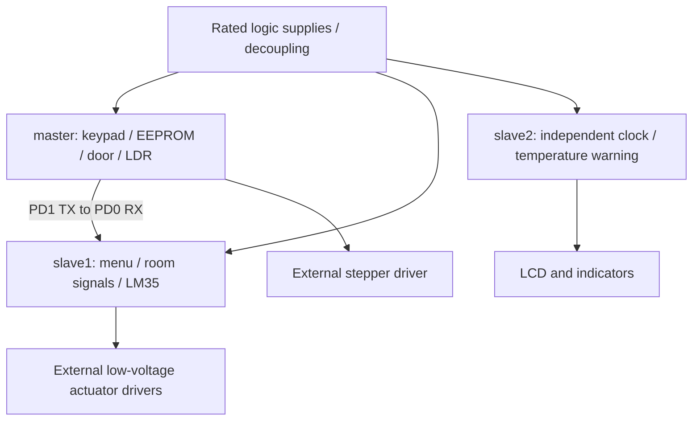

# Source-derived connection guide

This is a logical guide from active code, not an as-built schematic. Proteus
model references support ATmega32/LM35/banked EEPROM/LCD intent, but the original
project was not executed here. Confirm nets and actual parts before connecting.

Share a suitable signal ground for UART. Separate load supplies/returns from
logic as appropriate; use driver transistors/arrays and flyback protection. Do
not connect mains or heavy loads to the demonstrator. Supply, fuse, current and
driver choices are not verified by compiling firmware.

## Shared MCU assumptions

- ATmega32 direct register map, **8 MHz** clock. UART divisor 51 gives nominal
  9600 baud at this clock; format is 8N1. Verify oscillator/fuses rather than
  applying undocumented fuse values. No automatic fuse programming is supplied.
- LCD is four-bit: RS PB0, RW PB1, E PB2, D4–D7 PB4–PB7. Confirm controller type,
  contrast and geometry; source uses four display rows although the Proteus archive
  also contains a two-row LCD model reference. PB3 is available for light output.
- LM35 output must remain within ADC input limits; software assumes 5 V AVCC and
  10 mV/°C. Measure reference voltage and sensor behavior. ADC0 is PA0, ADC1 PA1,
  ADC3 PA3. Do not infer calibrated temperature from a host test.
- PC2–PC5 overlap ATmega32 JTAG. Verify disable/configuration for GPIO use using
  the correct device documentation and actual hardware settings.
- Keypad rows use pull-ups and active-low column scans. The map is 7/8/9,
  4/5/6, 1/2/3, `*`/0/`#`. One event per press is reported; measured electrical
  debounce is still required.

## Controller pin maps

| Controller | Connection | Pins |
|---|---|---|
| master | Keypad columns 1–3 | PA0, PA1, PA2 |
| master | Keypad rows 1–4 | PA4, PA5, PA6, PA7 |
| master | Stepper driver inputs | PD4 blue, PD5 pink, PD6 yellow, PD7 orange (source labels; verify actual coil order) |
| master | LDR divider / output indicator | PA3 / PB3 |
| master | Success / failure / buzzer | PC2 / PC3 / PC4 |
| master | UART | PD1 TX → slave1 PD0 RX; PD0 remains input |
| slave1 | Start button | PD6 to ground when pressed; pull-up enabled |
| slave1 | Keypad columns 1–3 | PD2, PD4, PD5 |
| slave1 | Keypad rows 1–4 | PD7, PA5, PA6, PA7 |
| slave1 | LM35 | PA0 |
| slave1 | Living-room light / AC / heater | PC2 / PC3 / PC4 |
| slave1 | Room-1 light / AC / heater | PC5 / PC6 / PC7 |
| slave1 | Room-2 light / AC / heater | PA2 / PA3 / PA4 |
| slave1 | Garden gate / light | PD3 / PB3 |
| slave2 | Clock-entry button | PC0 to ground when pressed; pull-up enabled |
| slave2 | Clock keypad columns / rows | PD0–PD2 / PD4–PD7 |
| slave2 | LM35 | PA1 |
| slave2 | Normal / warm / alarm / buzzer | PC1 / PC2 / PC3 / PC4 |

All AC/heater/gate names describe software outputs, not verified appliance wiring
or polarity. Keep loads isolated and use LEDs/logic analyzers first. The master
stepper API counts phase cycles, not degrees; its unverified 60/73 forward/reverse
defaults require mechanical review before moving any door.

## External EEPROM

ATmega32 hardware TWI uses PC0 SCL and PC1 SDA. Provide appropriate pull-ups and
address straps per the exact EEPROM. Source uses base 7-bit address `0x50`,
bank bits in the device address, one-byte word addressing and final-byte NACK.
This fits the intended banked 24Cxx approach; it does not implement two-byte
word addressing for larger parts. Proteus references include 24C04F and 24C08,
but actual populated parts and topology are not confirmed.

Demo PIN storage uses first-bank offsets `0x34` and `0x45`, each holding two
decimal digits (0–99). This changes the legacy invalid high address constants;
re-provision the demonstration PIN rather than relying on old EEPROM contents.
Master and slave1 both act as TWI masters in source. Confirm whether they share
one EEPROM/bus or use separate circuits before connecting; no validated
multi-master arbitration/ownership protocol exists.
